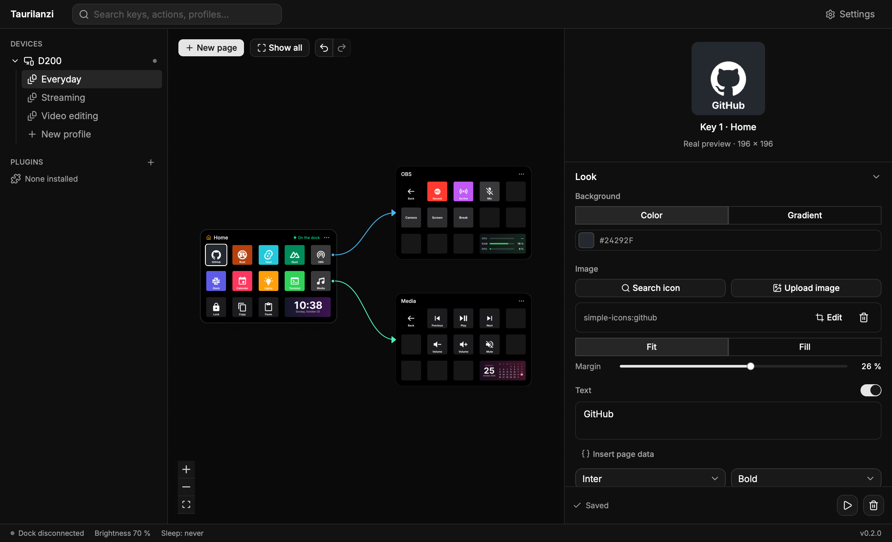
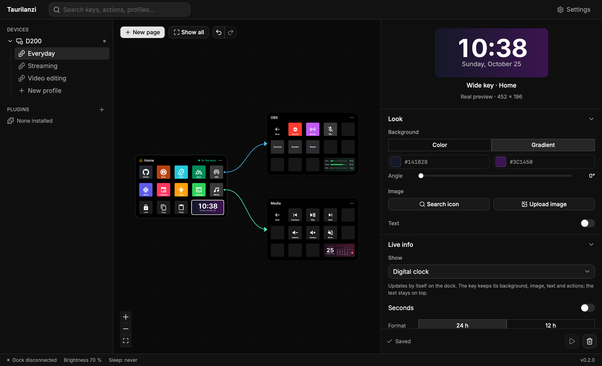
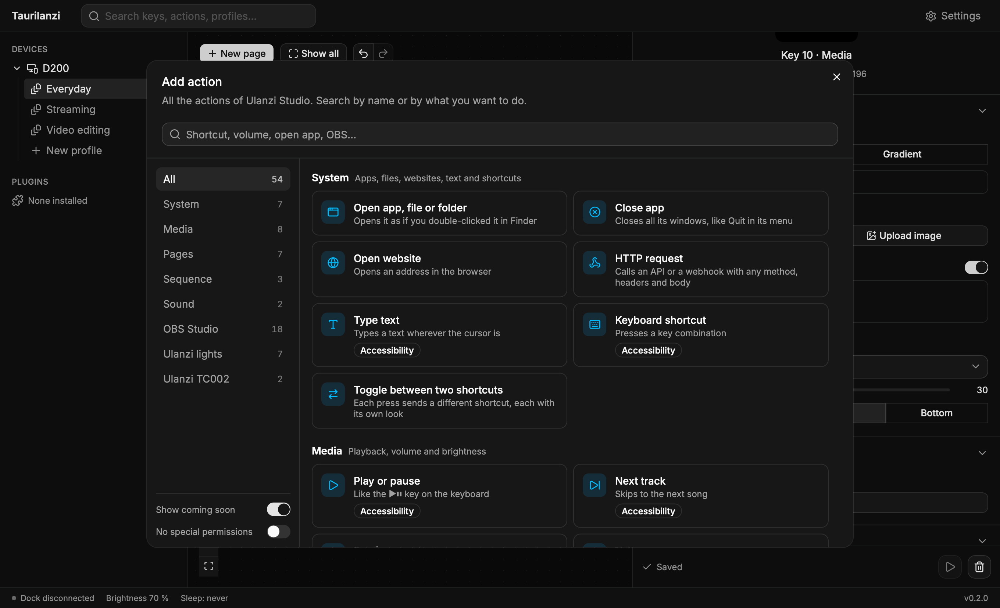
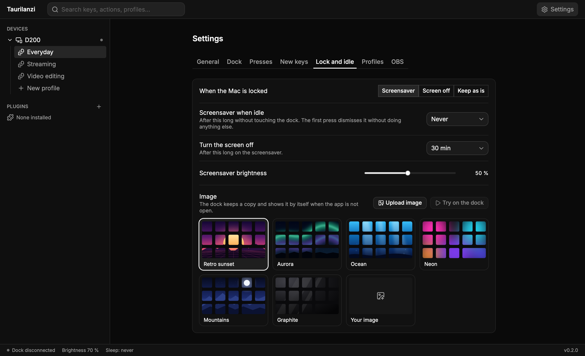

<div align="center">

<h1>
  <picture>
    <source media="(prefers-color-scheme: dark)" srcset="docs/brand/logo-white.svg">
    
  </picture>
</h1>

[](https://github.com/fstechlabs/taurilanzi/releases/latest)
[](https://github.com/fstechlabs/taurilanzi/actions/workflows/tests.yml)
[](LICENSE)

[](https://tauri.app)

**A fast, free desktop app for Ulanzi stream docks.**

Design your keys, wire up pages on a canvas, put live information on the wide key and keep using the
plugins made for Ulanzi Studio, all from a native app that lives in your menu bar or system tray.

**[taurilanzi.com](https://taurilanzi.com)**

Built with [Tauri](https://tauri.app) and Rust · Works with the Ulanzi D200 · macOS, Windows and Linux



</div>

> [!WARNING]
> Windows and Linux support is new and has not been tried on real machines yet: the app builds
> for both, but the dock, the actions and the installers are still to be checked there. macOS is
> the system it is used on every day.

---

## Why

The D200 is a great piece of hardware. Taurilanzi gives it software to match: a light native app
that starts with your computer, draws every key on your computer with real fonts, emoji and
transparency, and never needs an account or a connection to work.

It is not affiliated with Ulanzi. It talks to the dock directly and reads the plugins published
for Ulanzi Studio, so you can switch without losing what you already use.

## Features

### Keys that look the way you want
- Backgrounds, gradients, images with a built-in crop editor, icons from thousands of open icon
  sets, and text with any font on your computer.
- Every key is rendered on the computer as a full image, so emoji, transparency and custom fonts
  just work on the dock.
- Live preview of every change, with undo and redo for everything.

### Pages on a canvas
- Each page is a miniature dock on a canvas; draw a line from a key to a page to make it open it.
- Back and Home keys, page indicators, and drag and drop everywhere.

### Actions for everything
- Open apps, files and websites, keyboard shortcuts, typing text, media keys and volume, sounds,
  delays and random actions.
- Keys with two states, and different actions for a press, a double press and a long press.
- **OBS Studio** over obs-websocket: record, stream, scenes, sources, filters, the mixer and more,
  with keys that follow what OBS is doing.
- **HTTP requests** to any API or webhook, with any method, headers and body, and a ✓ or ✗ on the
  key when it answers.

### Profiles that follow you
- Several profiles, each linked to the apps you use: switch to an app and the dock switches with
  it.
- Optional sync with a Taurilanzi Cloud account: your profiles and settings, passwords included,
  stay the same on all your computers. They are stored encrypted, with their versions, so you can
  go back to an earlier one, and any profile can stay on one computer only.

### Live content on the wide key
Twenty widgets that keep themselves up to date on the dock:

| | | | |
|---|---|---|---|
| Digital clock | Analog clock | World clocks | Clock in words |
| Calendar | Countdown | Timer | Stopwatch |
| Counter | System monitor | Network | Temperatures |
| Top processes | Latency | Battery | Volume |
| Now playing | Moon phase | Time progress | Phrases |

Timers, stopwatches and counters answer to the key itself: press to start or add, hold to reset.

### Ulanzi Studio plugins, unchanged
- The plugins published for Ulanzi Studio run as they are, with their own settings pages.
- Install them from a ZIP or a folder, or browse the community catalog and install in one click,
  with update notices.
- Plugins run on a Node bundled with the app: nothing else to install.

### In your language
- Spanish and English, following your system's language, or the one you pick in the settings. Even
  the texts drawn on the keys (dates, the clock in words, the moon phases) change with it.

### At home on your computer
- Lives in the menu bar or the system tray and starts with your session.
- A still screensaver when you lock your computer or leave the dock alone.
- Brightness and sleep settings, and automatic updates.
- macOS 13 or later, Windows 10 and 11, and Linux (`.AppImage`, `.deb` and `.rpm`), on Intel/AMD
  and Arm. On Linux the app asks once for the administrator password, to let you use the dock and
  its virtual keyboard; on GNOME, switching profiles with the app in front needs a small extension
  the app installs for you.

## Screenshots

| Live content on the wide key | Every action in one place | A screensaver for the dock |
|---|---|---|
|  |  |  |

## Getting started

Taurilanzi is in active development. To run it from source you need
[Rust](https://rustup.rs), [Bun](https://bun.sh) and Node 24. On Linux, also the libraries Tauri
needs and a few of the app's own:

```bash
sudo apt install libwebkit2gtk-4.1-dev libayatana-appindicator3-dev librsvg2-dev \
  libudev-dev libxdo-dev libasound2-dev libxkbcommon-dev
```

```bash
bun install            # dependencies, and the Node that runs plugins
bun run tauri dev      # the app, talking to the dock
```

Only one app can talk to the dock at a time: quit Ulanzi Studio before starting Taurilanzi. To work
on the interface while Ulanzi Studio keeps the dock, use `bun run dev:no-dock`.

```bash
bun run test                       # UI unit tests
bun run typecheck
cd src-tauri && cargo test         # engine tests
bun run e2e                        # end-to-end tests against the real app
```

## How it works

```
┌───────────────── Taurilanzi ─────────────────┐
│  UI (Nuxt + shadcn-vue)                      │
│        │  Tauri IPC                          │
│  Engine (Rust) ── renderer (resvg) ──► USB   │──► Ulanzi D200
│        │                                     │
│  Plugin host ── WebSocket :3906 ── Node      │──► Ulanzi Studio plugins
└──────────────────────────────────────────────┘
```

- **Engine**: one Rust thread owns the configuration, the pages on the dock and every key press.
- **Renderer**: keys are composed as SVG and rasterized with `resvg`, then sent to the dock.
- **Driver**: speaks the D200's HID protocol directly, with no vendor library.
- **Plugin host**: implements the Ulanzi Studio plugin protocol, serves the plugins' pages and
  runs them on the bundled Node.

## Contributing

Issues and pull requests are welcome. Read [`CONTRIBUTING.md`](CONTRIBUTING.md) first: it explains
how to propose a change and points to [`AGENTS.md`](AGENTS.md) for the layout of the project, the
commands and the conventions.

## License

Copyright © 2026 FS Tech Labs.

Taurilanzi is free software, licensed under the [GNU Affero General Public License v3.0](LICENSE)
(AGPL-3.0-only). You may use, study, modify and share it. Any modified version you distribute, or
offer to others over a network, must be released under the same license, with its full source code
and the original copyright notices.

## Disclaimer

Taurilanzi is an independent project, not affiliated with or endorsed by Ulanzi. "Ulanzi" and
"Ulanzi Studio" are names of their respective owners, used only to describe compatibility.
